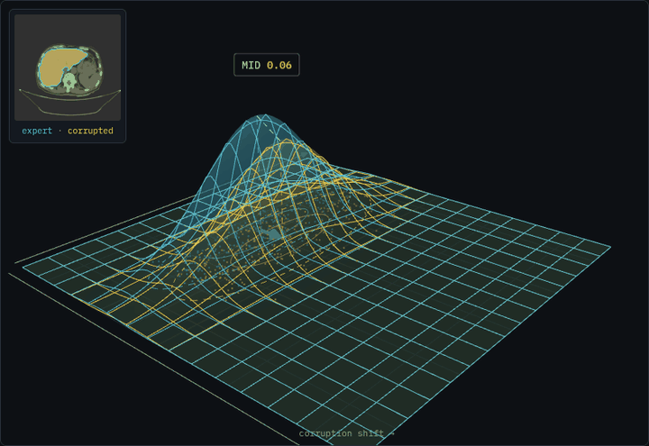

# pytorch-mid

**MID: Mask-Image Distributional Divergence for Evaluating Medical Image Segmentation**

NeurIPS 2026 (poster). Paper: [arXiv:2610.17354](https://arxiv.org/abs/2610.17354). Project page: [erc-caravel.github.io/pytorch-mid](https://erc-caravel.github.io/pytorch-mid/). Code tutorial: [tutorial.html](https://erc-caravel.github.io/pytorch-mid/tutorial.html).

MID is a distribution-level metric for medical image segmentation. It compares a reference set of image-mask pairs with a candidate set of image-mask pairs. The reference set holds ground-truth masks. The candidate set holds predicted masks. The two sets need no sample-wise correspondence. Ground-truth masks are thus needed only for the reference set.

MID uses the joint distribution of images and masks. A mask can have a plausible shape and still be wrong for its image. A joint score detects this case.

<p align="center">
  <a href="https://erc-caravel.github.io/pytorch-mid/"></a>
</p>
<p align="center"><sub>Liver, CT (AMOS22). The masks are dilated from clean to extreme. The candidate distribution (yellow) moves away from the reference distribution (blue), and MID rises. MID is scaled per organ, with a maximum of 1. The <a href="https://erc-caravel.github.io/pytorch-mid/">project page</a> shows other organs and corruptions.</sub></p>

## Method

1. Encode each image once with a pretrained medical vision encoder.
2. Encode each foreground class as a separate binary mask with the same encoder.
3. Concatenate the two vectors in the order `[image ‖ mask]`. Each image-mask pair gives one joint vector per foreground class.
4. Project the joint vectors to `k` dimensions with PCA. Fit the PCA on the reference set.
5. Fit one Gaussian to each projected set. Report the squared 2-Wasserstein distance between the two Gaussians.

$$
\mathrm{MID}(P, Q) = \lVert \mu_P - \mu_Q \rVert^2 + \mathrm{Tr}\left(\Sigma_P + \Sigma_Q - 2\left(\Sigma_P^{1/2}\,\Sigma_Q\,\Sigma_P^{1/2}\right)^{1/2}\right)
$$

Here $P$ is the reference distribution and $Q$ is the candidate distribution. $(\mu_P, \Sigma_P)$ and $(\mu_Q, \Sigma_Q)$ are the empirical means and covariances of the projected joint vectors. For two Gaussians, this quantity is the squared Fréchet distance (Dowson and Landau, 1982).

## Installation

The package is not on PyPI yet. Install it from GitHub:

```bash
pip install git+https://github.com/erc-caravel/pytorch-mid
```

For development, clone the repository and install it in editable mode:

```bash
git clone https://github.com/erc-caravel/pytorch-mid
cd pytorch-mid
pip install -e .
```

The package needs Python 3.9 or later, NumPy, SciPy and scikit-learn.

## Input features

The package computes MID from pre-extracted joint feature vectors. It does not include an encoder. The paper uses MedSigLIP (`google/medsiglip-448`) with the settings below. Use the same settings for the reference set and for every candidate set. The [code tutorial](https://erc-caravel.github.io/pytorch-mid/tutorial.html) gives an encoder with these settings.

| Setting | Value |
| --- | --- |
| Encoder | MedSigLIP (`google/medsiglip-448`), frozen |
| Embedding | Pooled output, ℓ2-normalised, d = 1152 |
| Joint vector | `[image ‖ mask]`, 2d = 2304 |
| Axial slices per volume | 16, uniformly sampled; all slices if the volume has 16 or fewer |
| 3-D volumes | Mean of the 16 slice embeddings |
| 2-D inputs | Same path with one slice |
| CT rendering | Three HU windows as RGB channels: [-1024, 1024], [-135, 215], [0, 80] |
| MRI rendering | Per-slice min-max scaling to 8 bits, replicated to 3 channels |
| Mask rendering | One binary mask per foreground class, white on black |
| Projection | PCA, k = 128, fitted on the reference set |

Keep the image and its label map on the same voxel grid. Use the same slice indices for the image and for the mask. Keep the order `[image ‖ mask]`. The decomposition reads the first half of each vector as the image block.

The package estimates each covariance with the empirical estimator. It adds 1e-6 to the diagonal for numerical stability. The paper uses Ledoit-Wolf shrinkage.

## Quick start

### MID from feature vectors

```python
import numpy as np
from pytorch_mid import compute_mid_from_latents, PCAProjection

ref  = np.load("reference_features.npy")   # (N_ref, 2304), ground-truth pairs
cand = np.load("candidate_features.npy")   # (N_cand, 2304), predicted pairs

proj  = PCAProjection(k=128).fit(ref)      # fit on the reference set only
score = compute_mid_from_latents(ref, cand, projection=proj)
print(f"MID = {score:.4f}")
```

A lower score means that the candidate distribution is closer to the reference distribution.

### Command line

```bash
pytorch-mid latents --ref reference_features.npy --cand candidate_features.npy --k 128
```

The command fits the PCA on the reference file. Use `--projection pca.pkl` to load a saved `PCAProjection` instead.

### Symmetric variant

The default estimator fits the PCA on the reference set. MID is therefore asymmetric in P and Q. For a symmetric score, fit the PCA on the union of the two sets:

```python
proj_sym  = PCAProjection(k=128).fit(np.vstack([ref, cand]))
score_sym = compute_mid_from_latents(ref, cand, projection=proj_sym)
```

### Decomposition into image, mask and correspondence terms

`compute_mid_decomposed` splits each input vector at its midpoint. It reads the first half as the image block and the second half as the mask block. A joint PCA mixes the image and mask coordinates. Project each half with its own PCA before the call:

```python
from pytorch_mid.decomposition import compute_mid_decomposed

d = ref.shape[1] // 2                                   # image block size
pca_img  = PCAProjection(k=128).fit(ref[:, :d])
pca_mask = PCAProjection(k=128).fit(ref[:, d:])

def blockwise(x):
    return np.hstack([pca_img.transform(x[:, :d]), pca_mask.transform(x[:, d:])])

parts = compute_mid_decomposed(blockwise(ref), blockwise(cand))
print(parts["img"], parts["mask"], parts["cross"])
```

The function returns `total`, `img`, `mask` and `cross`. The key `cross` is the residual correspondence term MID<sub>corr</sub> of the paper: `cross = total - img - mask`. Random shuffling of image-mask pairs leaves `img` and `mask` unchanged and increases `cross`.

## Properties

| Property | Holds |
| --- | --- |
| Non-negative | Yes |
| Zero for two equal Gaussian fits | Yes |
| Per-sample pairing between reference and candidate | Not required |
| Symmetric in P and Q | No, with the default reference-fitted PCA. Yes, with the union-PCA variant. |
| Triangle inequality | No. MID is a squared distance. |

## Usage guidance

These operating points come from the sample-size analysis of the paper.

- Use MID as a standalone score with at least 250 representations per group.
- Between 100 and 250 representations, subsample all candidate sets to the smallest size before comparison.
- Below 100 representations, use MID for exploratory analysis or for comparisons at a fixed candidate size.
- A group is one anatomy. One image gives one representation per anatomy.
- The reference estimate stabilises above 250 representations.
- The absolute scale of MID depends on the anatomy. Compare a score with the reference range of its anatomy. The file [`results/anatomy_reference_index.csv`](results/anatomy_reference_index.csv) gives these ranges.

## Results

The [`results`](results) folder holds the values behind three figures of the paper:

| File | Content |
| --- | --- |
| [`real_model_mid_vs_dice.csv`](results/real_model_mid_vs_dice.csv) | MID and mean Dice for real segmentation models |
| [`ixi_mra_pca2.csv`](results/ixi_mra_pca2.csv) | IXI MRA ground-truth and predicted-mask distributions in two principal components |
| [`anatomy_reference_index.csv`](results/anatomy_reference_index.csv) | Clean-versus-clean MID per anatomy |

[`results/README.md`](results/README.md) describes each column.

## Examples

```bash
python examples/random_vectors.py
```

The notebook [`examples/mid_demo.ipynb`](examples/mid_demo.ipynb) shows the same steps. The [code tutorial](https://erc-caravel.github.io/pytorch-mid/tutorial.html) shows the full path from NIfTI files to a score.

## Citation

```bibtex
@misc{marciano2026mid,
      title={MID: Mask-Image Distributional Divergence for Evaluating Medical Image Segmentation},
      author={Vincenzo Marcianò and Xiaoming Zhang and Gianluca Guglielmo and Michela Antonelli and Sebastien Ourselin and Maria A. Zuluaga},
      year={2026},
      eprint={2610.17354},
      archivePrefix={arXiv},
      primaryClass={cs.CV},
      url={https://arxiv.org/abs/2610.17354},
}
```

## License

Apache License 2.0.
